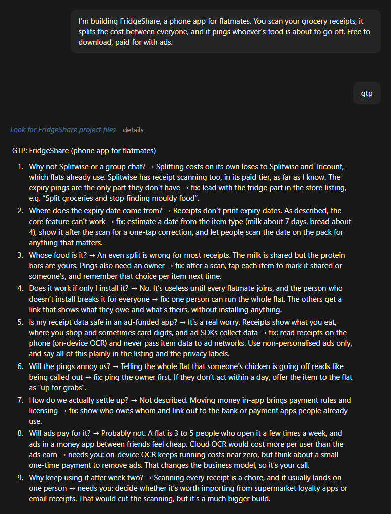

# gtp: grill the product

A Claude skill that looks at what you're building from the side of the person deciding whether to bother with it. Type `gtp` and Claude asks the questions a would-be player, user or downloader would ask, answers them honestly from the actual product, and fixes the gaps it finds.

Works for mods, games, apps, sites and tools.

## What it asks

- Would I notice it? Do the title and thumbnail say what it is in two seconds?
- Why this over the alternatives, or over doing nothing?
- Can I trust it? Real screenshots, clear requirements, a version number?
- How long from download to the good part?
- What breaks, confuses or annoys me? Does it uninstall cleanly?
- Why would I keep it, come back, or tell a friend?

Games also get asked whether the first minute is fun, whether the goal is clear, and whether there's a reason to play again.

Claude answers each one from what the product actually does, and a weak answer counts as a gap. It makes safe fixes (code, defaults, page copy, install steps) right away. Anything that costs money, goes public, or changes what the product is, it lists for you to decide.

## Example

A real run on a made-up app idea:



FridgeShare was only an idea with no files, so the fixes above are suggestions. On a real project, gtp answers from your code and pages, makes the safe fixes itself, and leaves the rest to you, like 8 and 9.

## Install

Claude Code:

```
npx skills add kevlar10x/gtp -g
```

Or copy `SKILL.md` into `~/.claude/skills/gtp/`.

claude.ai: put `SKILL.md` in a folder named `gtp`, zip the folder, and upload it under Settings → Capabilities → Skills.

## Use

Say `gtp` (or `/gtp` in Claude Code) while you're working on something.

## Credit

Made by kevlar10x. The idea grew out of Matt Pocock's [grill-me](https://github.com/mattpocock/skills) skill (MIT). gtp points the questions at the product from a user's point of view, and Claude answers them itself.

MIT license.

Tips are optional: https://ko-fi.com/kevlar10x
